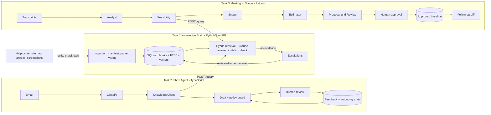

# DESIGN

> Draft written for you. Before submitting, rewrite the "problem" section in your own words and update every claim to match what you actually built and measured. You must be able to explain every line in the live review.

## 1. The problem
Code is cheap now; a client who paid $2,000 for a change two years ago pays about $200. A software business keeps its salaries only if each person handles 10-20x more clients. The slow parts are no longer coding but (a) knowing the product well enough to answer anything, (b) replying to every customer email fast and correctly, and (c) turning vague client meetings into a scope, an estimate and a proposal. We build one system that does all three and improves from the people who use it.

Needs nobody wrote down (found while designing):
- **Wrong answers cost more than slow answers.** The system must say "I don't know", route to a human, and the human's answer must flow back.
- **A refund promise or a price in an AI draft is a commercial commitment.** Code, not just the prompt, checks for them.
- **"No result in the docs" is not "feature doesn't exist".** Feasibility must not turn a retrieval miss into custom-development hours.
- **Scope creep happens in follow-up meetings**, so changes are compared to the *approved* baseline, never to an AI draft.
- **Autonomy must be revocable**, with an audit trail.

## 2. Architecture

Tasks 2 and 3 import nothing from Task 1; they use `POST /query` (typed, with timeouts, retries and an API key). Updating an article in Task 1 changes the answers both downstream tasks see, with no copied data.

## 3. Task 1: Knowledge Brain
- **Crawler.** Sitemap -> manifest (SQLite) -> diff into new / changed / unchanged / removed. Concurrency 3, 1 s between requests, robots.txt respected, exponential backoff with jitter on 429/5xx, no retries on permanent 4xx. Every page's status is checkpointed, so a stopped run resumes; one failed page never stops the run.
- **Daily freshness.** A scheduler runs the same incremental job. Removed pages are deleted from both indexes at once (a test proves they stop appearing in answers). Unchanged content hashes skip re-embedding; chunk ids are deterministic and replaced atomically, so reprocessing never duplicates.
- **Images.** Each screenshot is fetched, described by a vision model (visible labels, uncertainty flag) and stored as its own chunk tied to its article and the paragraph before it. The model is told to say "unclear" rather than invent labels.
- **Chunking.** Split at headings; block-level overlap; table headers repeated on every row; title and heading prefixed to every chunk.
- **Retrieval.** Hybrid: vector cosine (local bge-small via fastembed, no extra API key) plus SQLite FTS5 BM25, merged with reciprocal rank fusion. `run_eval --retrieval-only` compares vector, keyword and hybrid on real cases before we trust the choice. Reranking was left out (section 7).
- **Answering.** Evidence goes to the model as tagged *data*. The model returns JSON with cited chunk ids; invented ids are discarded; no valid citation means no answer. If the best cosine is under a threshold we abstain without calling the model. The API returns `evidence_score` (best cosine), deliberately **not** called confidence because it is not calibrated.
- **Escalation.** Insufficient evidence -> open task, deduplicated by normalised question. Expert answers are versioned, carry a scope note and optional expiry, and become searchable only when marked reviewed. Every escalated question is appended to the eval set.
- **Why SQLite.** One file, no server, FTS5 built in, enough for the few thousand chunks a help center has; brute-force numpy cosine is fast at that size. Past ~100k chunks, move to pgvector or Qdrant.

## 4. Task 2: Inbox Agent
- **Pipeline.** classify (fast model) -> ask Knowledge Brain -> draft (stronger model) -> policy guard -> human review. Email text is wrapped as untrusted data.
- **Never fabricate.** Knowledge service down -> no draft and a visible "service unavailable" banner. No evidence for a product question -> deterministic holding reply plus escalation.
- **Policy guard (code).** Flags invented prices, refund promises, delivery/guarantee promises, legal language and links not in the evidence. Any flag forces human review.
- **Learning.** Every review stores draft, final text, reason and prompt version. Edits become *candidate style rules* per category. A candidate is activated only if, on past reviewed emails, its regenerated drafts land closer to what humans actually sent **and** raise no more policy flags. Rollback restores the parent version.
- **"20 in a row" as built.** *Same kind* = category + primary cited article. *Without changing* = identical after whitespace and case normalisation (clicking Approve is not enough; "edit" with no change counts as unedited). 20 unedited in a row makes a kind **eligible** only; a human must switch it on. It never applies to refund, complaint, quote or project emails, high-risk or urgent mail, mail with policy flags, or mail without evidence. Every 5th auto-send is held for human audit; any edit, or an edit rate above 20% in the last 10, switches the kind off. There is a manual kill switch and an audit log. A unique constraint blocks duplicate sends.
- **Delivery is simulated** (an outbox table). Real SMTP is out of scope.

## 5. Task 3: Meeting to Scope
- **Five agents, one job each:** Analyst (what was said), Feasibility (what the product already does, via Task 1), Scope, Estimator, Proposal and Review. Each hands a typed record to the next.
- **Long transcripts.** Overlapping line windows -> parallel extraction -> merge of duplicates -> evidence check. Every quote the model returns is verified verbatim against the transcript *in code*; a requirement with no verified quote cannot be "confirmed".
- **Honest scope.** Only confirmed requirements can appear as agreed; code moves uncertain and removed items to open questions or exclusions even if the model listed them as agreed.
- **Estimates.** The model proposes tasks with low/likely/high hours; code repairs ordering, drops tasks for unknown requirements, and computes totals and the indicative price from a configurable rate. The proposal's hour figures are checked against those totals.
- **Follow-ups.** Compared with the latest *approved* version. Requirement ids stay stable; additions are flagged out-of-scope for re-quote; removals are flagged; modified requirements return to "unclear" and are re-estimated, while unchanged work is carried over. Hallucinated baseline ids are ignored.
- **Approval gate lives in the store, not the UI.** `send` fails unless the version is approved; approval needs a reviewer name and acknowledgement of open consistency issues; an unapproved draft never becomes the baseline.

## 6. Model choices (hypotheses until EVALS.md has numbers)
Fast model (Haiku class) for classification, extraction, vision and feasibility; stronger model (Sonnet class) for answering, drafting, scope, estimates and proposals. Each split is tested by running the same cases on both models and comparing quality, cost and latency. Where the fast model matches, it replaces the strong one.

## 7. Dropped or deferred
Reranker; knowledge graph; real email (SMTP/IMAP) and SMS; calibrated confidence; multi-tenant isolation; speech-to-text for recordings (transcripts are pasted text); authentication on the Task 2 and 3 UIs.

## 8. What breaks
- Brute-force vector search will not scale past ~100k chunks.
- Vision descriptions can be wrong; they are flagged uncertain but not independently verified.
- The abstain threshold is a first guess; tune it with the retrieval and abstention evals.
- Hour estimates have no historical calibration; judge them against a human reference estimate.
- "Same kind" by cited article is coarse: a new article splits the history.
- Scope diff relies on a model to match requirements by meaning and has only 4 eval cases; add more.

## 9. Next
Reranking and threshold tuning; calibrated confidence; Postgres with pgvector; real mailbox integration; estimate calibration against past projects; multi-tenant knowledge spaces.
